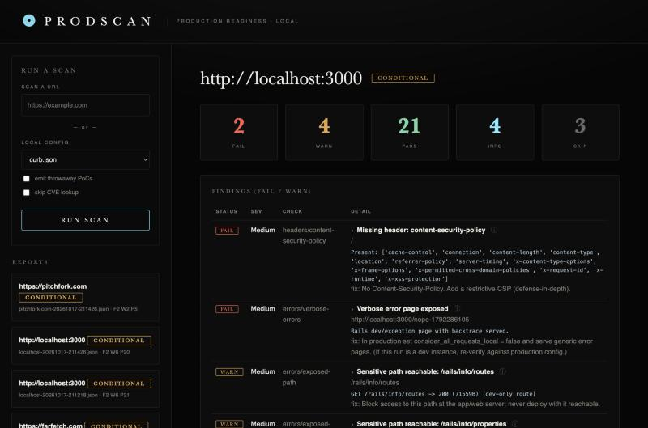

# Prodscan

A black-box **production-readiness security scanner** for web apps, with a native macOS dashboard. It probes a
*running* app (no source needed), runs ~30 security checks, fingerprints client-side libraries and matches their
versions to known CVEs via [OSV](https://osv.dev), and can have the [Anthropic API](https://docs.anthropic.com)
write a runnable proof-of-concept verifier for a finding — all behind a strict authorization gate.

Built for apps **you own or are authorized to test**: the full intrusive suite only ever runs against a local
host; any non-local URL is automatically restricted to passive, read-only checks.



*A CONDITIONAL verdict with KPI tiles, the FAIL/WARN findings table and per-finding evidence and fixes.*

## Quick start

Needs Python 3.8+ (standard library only — no `pip install`). The desktop app also needs macOS and the Xcode
Command Line Tools (`swiftc`).

```bash
python3 prodscan.py --target http://localhost:3000                    # a bare URL: auto-discovers signup/login/forms, full suite
python3 prodscan.py --config targets/example.json --out-md report.md  # a config + a Markdown report
python3 dashboard.py                                                  # the local, token-gated web UI (prints a 127.0.0.1 URL)
./build_app.sh && open ProdscanDashboard.app                          # build + launch the native macOS app
```

Copy `targets/example.json` to `targets/<yourapp>.json` and adjust the paths/fields to match your app (discover
them black-box — view the signup/login pages and their forms).

## How to use it

1. **Point it at a target.** Type a **URL** or pick a **config**. A **local host** (`localhost`, `127.0.0.1`,
   `*.localhost`, `*.test`) auto-discovers the app's signup, login and forms and runs the **full suite** — no
   config needed. Any **non-local URL** is forced to a **passive, read-only** profile. The UI tells you which
   before you run.
2. **Run a scan.** Findings come back as **PASS / FAIL / WARN / INFO / SKIP** with evidence and a fix, and the run
   ends on a **GO / CONDITIONAL / NO-GO** verdict.
3. **Review findings.** Each report shows a verdict badge, KPI tiles and the FAIL/WARN table. Hover the **ⓘ** on
   any finding (or status badge) for *why it matters*; **click a FAIL/WARN row** to expand a reproduction/exploit
   snippet for that check.
4. **Generate a PoC.** On a known-vulnerable-library finding, click **Generate PoC**. A client-side library CVE
   gets a self-contained **HTML harness** that actually fires the exploit — differentially against a patched
   version — right in the dashboard. Other findings get an AI-filled or stub read-only **Python verifier**.
5. **Run the PoC.** Click **Run PoC** (or open the HTML harness) to see **CONFIRMED / NOT / COULD-NOT-TEST**. PoCs
   are read-only and self-refuse against non-local targets unless you pass `--i-am-authorized`.

## Features

- **Safety by design:** the full intrusive suite — account creation, data mutation, brute-force, payloads — only
  runs against a local host; a non-local target is forced to passive read-only in both the engine and the UI.
  Every request is rate-limited, the brute-force check is bounded, and it only ever mutates throwaway
  accounts/objects it creates itself.
- **~30 checks:** transport & headers (CSP, HSTS, X-Frame-Options, nosniff, Referrer-Policy, banners), cookies,
  CORS, clickjacking, HTTP methods, error/debug exposure, content discovery, injection (reflected & stored XSS,
  SQLi, SSTI, open-redirect, host-header), access control (read/write IDOR, privilege escalation, format-handler
  bypass), mass assignment, CSRF, file upload, and auth flows (user enumeration, login rate-limiting, password
  policy, session fixation, logout invalidation, password reset).
- **Dependencies → CVEs:** fingerprints JS libraries from the importmap, asset URLs and JS content, and matches
  versions to advisories via OSV.
- **Explained findings:** evidence and a fix for every result, a GO/CONDITIONAL/NO-GO verdict, a "why it matters"
  tooltip per finding and status, and a one-click reproduction/exploit snippet.
- **Runnable PoCs:** a vulnerable client-side library gets a self-contained HTML harness that fires the exploit
  against the detected version (and shows it stays safe on a patched one); other findings get a read-only Python
  verifier, AI-filled when a key is set or a reviewed stub otherwise.
- **Hardened dashboard:** binds to `127.0.0.1` only, requires a per-launch access token (defeats CSRF) and pins
  Host/Origin (defeats DNS rebinding). "Run" launches a validated, fixed command — never an arbitrary shell.

## The scanner & PoCs

Run the engine directly, or drive it from the dashboard:

```bash
python3 prodscan.py --config targets/curb.json --out-md report.md --out-json report.json   # full run, both report formats
python3 prodscan.py --target https://example.com                 # non-local: auto-restricted to passive, read-only checks
python3 prodscan.py --target http://localhost:3000 --no-cve      # skip the OSV CVE lookup (offline / faster)
python3 prodscan.py --config targets/curb.json --emit-pocs       # also emit throwaway PoC verifiers for findings

export ANTHROPIC_API_KEY=sk-ant-...                              # optional: AI-fills PoC verifiers
#   or write the key to ~/.config/prodscan/anthropic_key so the desktop app finds it across relaunches
```

PoCs are read-only and self-refuse against non-local targets unless you pass `--i-am-authorized`; review the
generated code before running it.

## Files

| File | What it is |
|---|---|
| `prodscan.py` | the scanner engine + GO/NO-GO reporting |
| `bbscan.py` | the HTTP client (cookies, redirects, multipart, rate-limiting) |
| `pocgen.py` | the AI / throwaway PoC-verifier generator |
| `dashboard.py` | the local, token-gated web UI + run backend |
| `app/main.swift`, `build_app.sh` | the native macOS WKWebView wrapper |
| `targets/example.json` | target config template |

## Disclaimer

For authorized security testing and production-readiness validation only. Do not point it at systems you do not
own or have explicit permission to test. You are responsible for how you use it.
